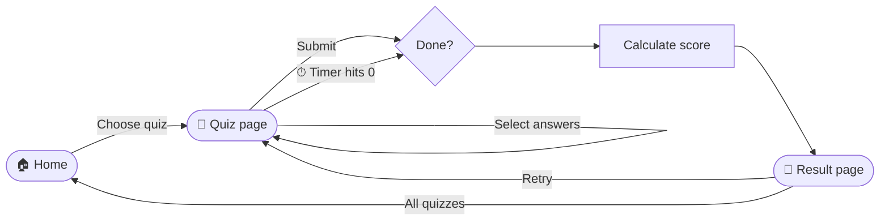

<div align="center">

# 🎓 Quiz & Assessment Portal

### A fast, interactive, timer-based quiz app built with React


**Full Stack Development II · Lab Mini Project · B.E. CSE/IT · Semester 5**

[✨ Features](#-features) • [🚀 Quick Start](#-quick-start) • [🧭 Routes](#-app-routes) • [🗂 Structure](#-project-structure) • [🧠 Concepts](#-react-concepts-demonstrated) • [➕ Add a Quiz](#-add-your-own-quiz)

</div>

---

## 📖 About

**Quiz & Assessment Portal** is a single-page application where students pick a subject, answer questions against a **live countdown timer**, and instantly get a **score with a detailed answer review**. It runs fully in the browser, so there is no backend or database to set up.

> 🎯 **Objective:** Implement question navigation, answer selection, a timer and score calculation using React Hooks and React Router.

---

## ✨ Features

| | Feature | Description |
|---|---|---|
| 📚 | **Multiple quizzes** | JavaScript, React and DBMS quizzes out of the box |
| ❓ | **One question at a time** | Clean radio-button answer selection |
| ⏱️ | **Countdown timer** | Turns red in the last 15 seconds and **auto-submits** at 00:00 |
| 🧭 | **Question palette** | Jump to any question; answered ones turn green |
| 📊 | **Progress bar** | Live view of how many questions are answered |
| 🏁 | **Instant results** | Score, percentage, correct / wrong / skipped, time taken |
| 🔍 | **Answer review** | See your answer vs. the correct one for every question |
| 🏆 | **Best score** | Saved per quiz in `localStorage` |
| 📱 | **Responsive UI** | Works on desktop, tablet and mobile |
| 🔁 | **Retry** | Retake any quiz in one click |
| 🎬 | **Smooth animations** | Page fades, sliding questions, hover lifts, pulsing low-time timer, animated score count-up and 🎊 confetti for 80%+ |

---

## 🖼️ Screens at a Glance

```
┌────────────────────────┐   ┌────────────────────────┐   ┌────────────────────────┐
│  🏠  HOME              │   │  📝  QUIZ              │   │  🏁  RESULT            │
│                        │   │                        │   │                        │
│  • JavaScript Basics   │ → │  Q 3 of 5     ⏱ 01:42  │ → │        4 / 5           │
│  • React Fundamentals  │   │  ▓▓▓▓▓▓░░░░  3 answered│   │   Excellent! 🎉 (80%)  │
│  • DBMS Essentials     │   │  ( ) var               │   │  ✅ Q1  ✅ Q2  ❌ Q3   │
│  🏆 Best: 4/5          │   │  (•) filter()          │   │  [ Retry ] [ Home ]    │
└────────────────────────┘   └────────────────────────┘   └────────────────────────┘
```

---

## 🚀 Quick Start

**Prerequisites:** [Node.js](https://nodejs.org/) 18+ and npm

```bash
# 1️⃣ Clone the repository
git clone https://github.com/PrasannaTheBest/Quiz-Assessment-Portal-sem5.git

# 2️⃣ Move into the project
cd Quiz-Assessment-Portal-sem5

# 3️⃣ Install dependencies
npm install

# 4️⃣ Start the dev server
npm run dev
```

Open **http://localhost:5173** 🎉

| Command | What it does |
|---|---|
| `npm run dev` | Start the development server with hot reload |
| `npm run build` | Create an optimized production build in `dist/` |
| `npm run preview` | Preview the production build locally |

---

## 🧭 App Routes

| Route | Page | Purpose |
|---|---|---|
| `/` | `Home` | List of available quizzes and best scores |
| `/quiz/:id` | `Quiz` | Take the quiz (`javascript`, `react`, `dbms`) |
| `/result` | `Result` | Score summary and review (redirects home if no quiz was taken) |

---

## 🔄 How It Works



---

## 🗂 Project Structure

```
Quiz-Assessment-Portal-sem5/
├── index.html
├── package.json
├── vite.config.js
└── src/
    ├── main.jsx                 # App entry + BrowserRouter
    ├── App.jsx                  # Routes and shared result state
    ├── styles.css               # Global responsive styling
    ├── data/
    │   └── quizzes.js           # Quiz questions (edit me!)
    ├── pages/
    │   ├── Home.jsx             # Quiz selection
    │   ├── Quiz.jsx             # Questions, timer, navigation
    │   └── Result.jsx           # Score and answer review
    └── components/
        ├── Timer.jsx            # Countdown display
        └── QuestionPalette.jsx  # Question jump buttons
```

---

## 🧠 React Concepts Demonstrated

- 🪝 **`useState`**: current question, selected answers, seconds left
- ⚙️ **`useEffect`**: `setInterval` countdown with cleanup, plus auto-submit at zero
- 📌 **`useRef`**: always reads the latest answers inside the timer, avoiding stale state
- 🧭 **React Router v6**: `Routes`, `Route`, `Link`, `useParams`, `useNavigate`, `Navigate`
- 🧩 **Reusable components**: `Timer`, `QuestionPalette`
- 🔀 **Conditional rendering**: Next / Submit button, correct / wrong / skipped styling
- 💾 **Web Storage**: best score persisted with `localStorage`
- 📤 **Lifting state up**: quiz result shared between `/quiz/:id` and `/result`

---

## ➕ Add Your Own Quiz

Open `src/data/quizzes.js` and append an object:

```js
{
  id: "python",
  title: "Python Basics",
  description: "Syntax, data types and functions.",
  timeLimit: 120,                       // seconds
  questions: [
    {
      question: "Which keyword defines a function in Python?",
      options: ["func", "def", "function", "lambda"],
      answer: 1,                        // index of the correct option
    },
  ],
}
```

It shows up on the home page automatically. ✅

---

## 🔮 Future Improvements

- [x] Smooth animations (respects `prefers-reduced-motion`)
- [ ] Shuffle questions and options
- [ ] "Mark for review" flag
- [ ] Dark mode toggle
- [ ] Per-question timers and difficulty levels
- [ ] Leaderboard with a backend (Express + MongoDB)
- [ ] User login with JWT

---

## 🎓 Academic Details

| | |
|---|---|
| **Course** | Full Stack Development II |
| **Program** | B.E. CSE / IT, 3rd Year |
| **Semester** | 5 (July–Dec 2026) |
| **Project** | #10, Quiz and Assessment Portal |
| **Tech** | React.js, Hooks, React Router |

---

<div align="center">

⭐ If you found this useful, consider giving the repo a star!

</div>
